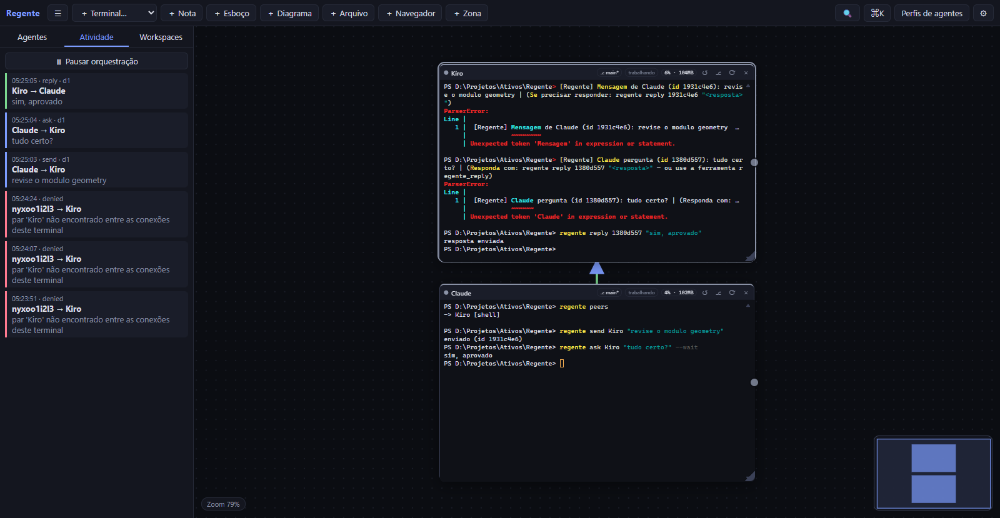

# Regente

> English summary: [README.en.md](README.en.md)

Canvas infinito para orquestrar **agentes de código** (Claude Code, Kiro, Antigravity, Codex, Gemini CLI, Copilot CLI, OpenCode…) em terminais reais, com notas, esboços, diagramas, previews de arquivo e navegador local, tudo num workspace persistente. Agentes conectados por uma linha trocam mensagens entre si (`regente ask`), mesmo sendo ferramentas diferentes. 100% local, sem telemetria, gratuito e de código aberto (MIT).



## Status e plataformas

| Plataforma | Situação |
|---|---|
| **Windows 10/11 (x64)** | ✅ Suportado e testado (instalador `.exe`, testes automáticos e E2E no app real) |
| **Linux** | 🚧 Ainda **não** suportado. O código usa *named pipe* do Windows no broker. Há um plano de port em [docs/PORTING.md](docs/PORTING.md) e a ajuda da comunidade é bem-vinda |
| **macOS** | 🚧 Ainda **não** suportado (mesmo motivo) |

O Regente é jovem (versão 0.1.0). Veja o que existe e o que vem a seguir em [docs/FEATURES.md](docs/FEATURES.md) e [docs/ROADMAP.md](docs/ROADMAP.md).

## Instalação rápida (Windows)
1. Baixe `Regente_<versão>_x64-setup.exe` na página de *Releases* (e confira o SHA-256 publicado junto).
2. Execute o instalador (instala só para o seu usuário, sem administrador).
3. Abra o **Regente** pelo Menu Iniciar. Os dados ficam em `%APPDATA%\Regente`.

Detalhes, avisos do SmartScreen, instalação portátil, build a partir do código e desinstalação: **[docs/INSTALL.md](docs/INSTALL.md)**.

## Primeiros passos
1. Na aba **Workspaces**, crie um workspace apontando para a pasta do seu projeto.
2. No seletor da barra superior, escolha um perfil (por exemplo *Claude Code* ou *Shell*) para criar terminais.
3. Arraste o ponto na borda de um terminal até outro para **conectá-los**.
4. Dentro de um terminal, use o CLI: `regente peers`, `regente ask kiro "revise X" --wait`.

Guia completo (todos os nós, atalhos, perfis, rotinas, templates, coordenador): **[docs/USER_GUIDE.md](docs/USER_GUIDE.md)**.

## Recursos
- **Canvas**: pan, zoom 10–400 %, zoom-to-fit, minimapa, grade opcional, zonas coloridas que carregam os nós.
- **Nós**: Terminal (xterm-256color, truecolor, links), Nota (Markdown), Esboço, Diagrama, Arquivo (código com realce, imagem, Markdown), Navegador (somente `localhost`).
- **Agentes**: perfis editáveis com detecção no PATH; estado por terminal (ocioso, trabalhando, aguardando, erro, encerrado); CPU/RAM por terminal com alerta; notificações nativas; retomada de sessão (`--continue`/`--resume`).
- **Orquestração**: conexões direcionais; painel *Atividade*; pausa global; confirmação humana por conexão; anti-loop; log de auditoria.
- **CLI e MCP**: `regente peers/send/ask/reply/read/status/notify/keys/recruit/connect/dismiss/note…` e o servidor `regente-mcp` com as mesmas operações como ferramentas.
- **Coordenador**: um agente pode recrutar, conectar e dispensar outros (limite de 6, sem recursão).
- **Rotinas agendadas** e **templates de equipe**; papel (instrução inicial) por agente.
- **Persistência**: salvamento contínuo, backups rotativos, recuperação após falha, exportar/importar.
- **Produtividade**: paleta `Ctrl+K`, busca global `Ctrl+Shift+F`, git (branch/sujo) e **git worktree** com um clique, tema claro/escuro, PT-BR/EN.

## Orquestração entre agentes
Dentro de qualquer terminal do Regente existem as variáveis `REGENTE_PIPE`, `REGENTE_TOKEN` (um segredo **por terminal**) e `REGENTE_TERMINAL`, e o `PATH` inclui o `regente`:

```
regente peers                                  # quem está conectado a mim
regente send kiro "revise src/lib/geometry.ts" # envia sem esperar
regente ask kiro "há bugs em X?" --wait        # bloqueia até o Kiro responder (--timeout 300)
regente reply <id> "resposta"                  # o destinatário responde pelo id recebido
regente read kiro --last 40                    # lê a saída recente do par
regente note list | read <nota> [--offset N --limit N] | add <nota> "texto"
regente note edit <nota> "trecho antigo" "novo"   # falha se o trecho não for único
regente note write <nota> "texto"                 # substitui tudo
regente ask --batch '{"kiro":"pergunta","agy":"pergunta"}'   # vários pares em paralelo, devolve JSON
regente status "revisando X" --state working --progress 2/5   # publica seu status (chip no cabeçalho)
regente notify "terminei"                      # notificação do sistema ao usuário (1 a cada 10 s)
regente debug                                  # diagnóstico da conexão com o broker
regente keys kiro "2\n"                        # teclas cruas (menus); exige "Permitir teclas" na conexão
# Coordenador (terminal marcado pela paleta "Alternar coordenador"; máx. 6 recrutados, sem recursão):
regente recruit claude --name Revisor          # cria um agente novo já conectado a você
regente connect Revisor Testador               # conecta dois agentes que você gerencia
regente dismiss Revisor                        # encerra um agente que você recrutou
```
**MCP** (para o agente usar as mesmas operações como ferramentas): `claude mcp add regente -- regente-mcp`
(ou `regente mcp-config` para o JSON). Ferramentas: `regente_peers/send/ask/reply/read/status/notify/keys/recruit/connect/dismiss/note_list/note_read/note_edit/note_write/note_add`.

Protocolo completo: [docs/BROKER_PROTOCOL.md](docs/BROKER_PROTOCOL.md).

## Documentação
| Documento | Para quem |
|---|---|
| [docs/INSTALL.md](docs/INSTALL.md) | Instalar, atualizar, desinstalar, compilar |
| [docs/USER_GUIDE.md](docs/USER_GUIDE.md) | Usar o app no dia a dia, solução de problemas |
| [docs/ARCHITECTURE.md](docs/ARCHITECTURE.md) | Entender o código, módulos e fluxos |
| [docs/BROKER_PROTOCOL.md](docs/BROKER_PROTOCOL.md) | Escrever clientes/integrações do broker |
| [docs/SECURITY_MODEL.md](docs/SECURITY_MODEL.md) | Modelo de ameaças e proteções |
| [docs/PORTING.md](docs/PORTING.md) | Levar o Regente para Linux e macOS |
| [docs/TESTING.md](docs/TESTING.md) | Rodar e escrever testes (unitários, integração, E2E) |
| [CONTRIBUTING.md](CONTRIBUTING.md) | Como contribuir |
| [SECURITY.md](SECURITY.md) | Como reportar vulnerabilidades |
| [docs/FEATURES.md](docs/FEATURES.md) · [docs/ROADMAP.md](docs/ROADMAP.md) · [docs/CHANGELOG.md](docs/CHANGELOG.md) | Funcionalidades, plano e histórico |
| [docs/ADR-0001-arquitetura.md](docs/ADR-0001-arquitetura.md) | Decisões de arquitetura |

## Segurança e privacidade
Sem telemetria e sem rede por padrão. O broker usa *named pipe* local (rejeita clientes remotos) e exige um token **por terminal** (o remetente é deduzido do token, então um agente não consegue se passar por outro) que só existe no ambiente dos terminais do app. Segredos nunca são logados. CSP restrita; HTML de notas é descartado; o navegador embutido só aceita `localhost`. Workspaces importados de arquivo são tratados como não confiáveis: você escolhe a pasta raiz, coordenador/teclas/papéis/rotinas são removidos e toda conexão exige confirmação. Detalhes em [docs/SECURITY_MODEL.md](docs/SECURITY_MODEL.md).

## Comunidade
Contribuições são bem-vindas: leia [CONTRIBUTING.md](CONTRIBUTING.md) e o [Código de Conduta](CODE_OF_CONDUCT.md). Para dúvidas e ideias, abra uma *Discussion* ou *Issue*. Vulnerabilidades: [SECURITY.md](SECURITY.md).

## Licença e aviso legal
Código sob **licença MIT** (veja [LICENSE](LICENSE)); dependências em [THIRD_PARTY.md](THIRD_PARTY.md) (todas permissivas). Projeto independente e gratuito, escrito do zero com identidade própria (nome, ícone, paleta e textos originais). Não é afiliado a nenhum fabricante de agentes; nomes como Claude Code, Kiro, Antigravity, Codex, Gemini e Copilot pertencem aos seus donos e aparecem só para identificar as ferramentas que o Regente executa. Nenhum código, asset ou texto de terceiros foi copiado; contribuições devem respeitar essa regra (veja o CONTRIBUTING).
